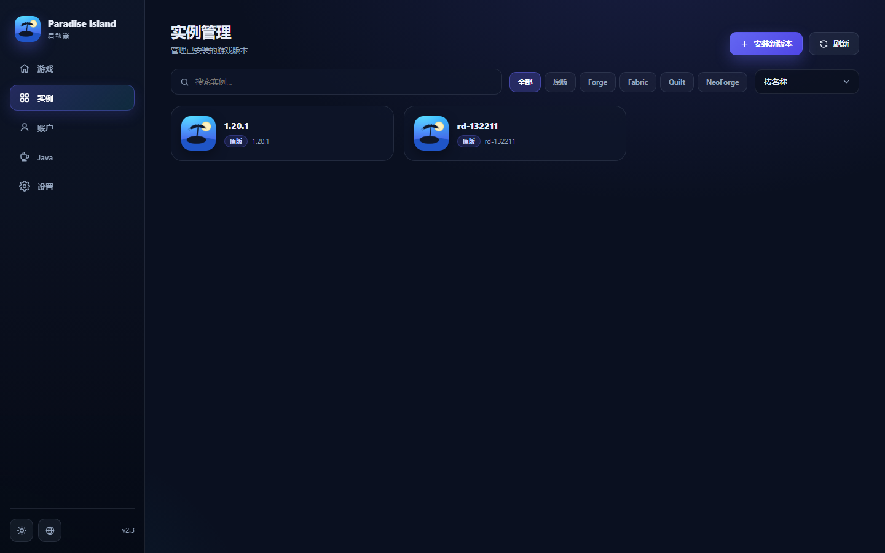
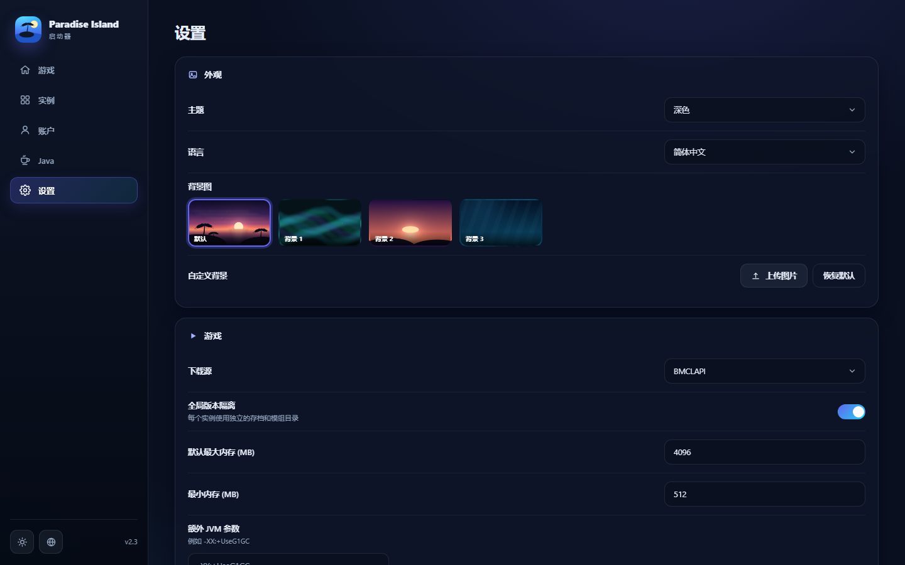

# Paradise Island Launcher

一个面向 Windows 的 Minecraft 启动器：Python + Flask 后端，浏览器界面，支持打包成单文件 exe。


## 功能

- **版本安装**：原版 / Forge / NeoForge / Fabric / Quilt，支持 BMCLAPI 与官方源，镜像失败自动回退和重试
- **多实例**：版本隔离、独立图标、独立内存 / Java / JVM 参数、显示名称
- **账户**：多个离线账户、微软账户登录
- **Mod 管理**：导入 `.jar`、启用 / 禁用、删除（实例右键 → 模组管理）
- **Java 管理**：自动检测并显示真实版本号，可从 Adoptium 一键安装 Temurin JDK
- **日志**：查看启动器日志 / 实例游戏日志，自动刷新
- **外观**：深色 / 浅色 / 跟随系统，4 张内置背景 + 自定义背景
- **10 种语言**：简体中文、繁體中文、English、日本語、한국어、Русский、Español、Français、Deutsch、Português (Brasil)
- **单文件 exe**：免安装，数据保存在 exe 同目录的 `minecraft/` 中，可整体拷贝




## 从源码运行

```bash
python -m pip install -r requirements.txt
python app.py
```

浏览器会自动打开 `http://127.0.0.1:10131`。如果端口被占用，会自动顺延（10132、10133…）。

## 构建单文件 exe

```bash
python -m pip install pyinstaller pillow
python tools/make_assets.py     # 重新生成图标/背景/启动画面（可选）
python build_exe.py
```

产物：`dist/Paradise Island Launcher.exe`（约 15 MB）。exe 首次启动会显示启动画面，解压完成后自动打开浏览器。请把 exe 放在有写权限的目录（例如桌面）：单文件模式会把运行文件临时解压到它所在的目录，首次启动约 10–20 秒。

## 目录结构

```
app.py                  Flask 后端：下载、安装、启动、账户、配置等接口
static/
  index.html            页面结构
  css/style.css         界面样式
  js/i18n*.js           多语言文本（10 种语言）
  js/app.js             前端逻辑
  images/               图标、背景、启动画面
tools/
  make_assets.py        生成图片资源（Pillow）
  check_i18n.js         校验多语言完整性（node tools/check_i18n.js）
  shot_steps.py         用无头 Chrome 截取交互状态截图
build_exe.py            打包单文件 exe
requirements.txt
screenshots/
minecraft/              运行数据（版本、库、资源、配置），首次运行自动创建
```

## 常见问题

- **端口被占用**：启动器自动改用后续端口；也可用环境变量 `PIL_PORT` 指定。
- **Java 找不到**：设置页“Java 路径”可手动指定，留空则自动检测；也可在 Java 页安装。
- **下载慢 / 失败**：设置页切换下载源，镜像异常时会自动回退官方源。
- **存档/模组在哪**：实例卡片右键 → “打开目录”；开启版本隔离后每个实例有独立游戏目录。
- **日志在哪**：设置页“查看启动器日志”，或实例右键 → “查看日志”；文件位于 `minecraft/launcher.log`。
- **怎么退出**：设置页底部“退出启动器”（浏览器页面关闭不会结束后台进程）。

## 说明

- 启动器只监听 `127.0.0.1`，不会暴露到局域网。
- 微软登录需要在 Azure 应用里把回调地址设为 `http://127.0.0.1:10131/api/auth/microsoft/callback`（端口改动时同步修改）。
