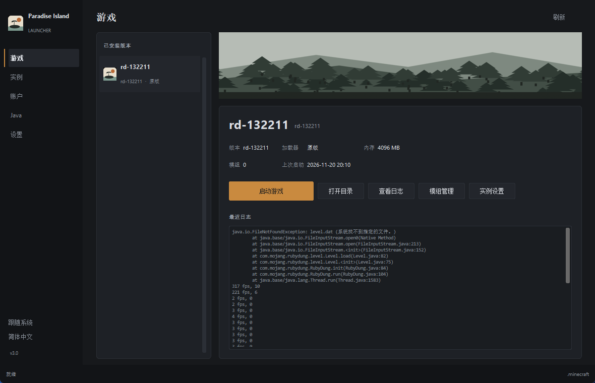

# Paradise Island Launcher

Windows 上的 Minecraft 启动器，原生桌面窗口，不使用浏览器。数据保存在 exe 旁边的 `.minecraft` 目录。



## 功能

- 版本安装：原版 / Forge / NeoForge / Fabric / Quilt，BMCLAPI 与官方源，失败自动回退重试
- 多实例：独立图标、内存、Java、JVM 参数、版本隔离
- 离线账户：多账户切换
- Mod 管理：导入、启用 / 禁用、删除
- Java：检测已安装版本并从 Adoptium 安装 Temurin JDK
- 日志：实例日志与启动器日志
- 10 种语言，深色 / 浅色 / 跟随系统
- 内置 4 张背景图，可上传自定义背景

## 目录

```
launcher.py          桌面界面
app.py               下载、安装、启动、账户、配置
static/i18n.json     多语言文本
static/images/       图标、背景、启动画面
tools/make_assets.py 生成图片资源
build_exe.py         打包单文件 exe
.minecraft/          游戏数据（首次运行自动创建）
```

## 从源码运行

```bash
python -m pip install -r requirements.txt
python launcher.py
```

## 构建 exe

```bash
python -m pip install pyinstaller pillow
python build_exe.py
```

产物：`dist/Paradise Island Launcher.exe`。单文件模式会把运行文件解压到 exe 所在目录，请放在有写权限的位置。

## 说明

- 游戏需要本机安装 Java；启动器会自动查找，也可在 Java 页或设置中指定。
- 下载源可在设置中切换；镜像异常时自动回退官方源。
- 日志位于 `.minecraft/launcher.log`，实例日志位于实例目录的 `logs/latest.log`。
- 关闭窗口即退出启动器，不会关闭已启动的游戏。
